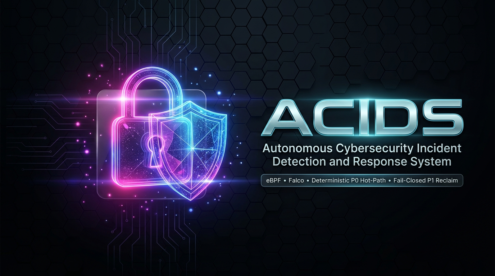

<div align="center">



<br/>
<br/>

[](https://github.com/Sain-Kai/ACIDS/releases)
[](https://opensource.org/licenses/MIT)
[](https://falco.org/)
[](https://golang.org/)
[](https://spring.io/)
[](https://ollama.ai/)
[](https://gvisor.dev/)
[](https://ipindia.gov.in/)

<br/>

[Quickstart](#-quickstart-guide) • [Architecture](#-end-to-end-architecture) • [P0 Hot-Path Engine](#-deterministic-p0-hot-path-engine) • [P1 Reclaim State Machine](#-autonomous-p1-fail-closed-reclaim-protocol) • [Downstream AI Pipeline](#-post-containment-ai-orchestration-ollama) • [Cross-Platform Installation](#-cross-platform-installation--setup) • [Verification & Testing](#-verification-testing--benchmarks) • [Academic & Patent](#-authors-academic-affiliation--ip-status)

</div>

<br/>

**Deterministic kernel telemetry, zero-hallucination containment.** ACIDS (*Autonomous Cybersecurity Incident Detection and Response System*) is an enterprise runtime defense platform built for mission-critical Linux workloads, Kubernetes nodes, and cloud-native infrastructure. Rather than relying on passive alerting or injecting unpredictable Generative AI models into the critical response loop, ACIDS enforces a strict, mathematically verified separation of concerns: a **deterministic P0 hot path** that executes sub-millisecond local containment directly on the host with zero network or model dependencies, and an **autonomous P1 fail-closed reclamation state machine** that restores compromised hosts back to a verified, tamper-free state.

**Local LLMs placed strictly downstream.** Generative AI models (Qwen 2.5 14B & Qwen 2.5 Coder via offline Ollama) operate **strictly post-containment** to synthesize multi-stage incident root causes, construct constrained defensive patch manifests (`BLOCK_IP` and `COMMAND_PATTERN`), and submit them to an adversarial AI Security Judge. Every autonomous policy change is strictly gated through canary deployments with automatic rollback against empirical telemetry baselines, and every single state transition is immutably anchored into a cryptographic SHA-256 audit hash chain.

```bash
$ ./scripts/run-mesh-defense.sh
ACIDS v1.0.0 • eBPF Modern Probes • Falco 0.45.0 • Go Hot-Path • Spring Boot 3.2 • Qwen 2.5 14B
✓ postgres relational event store online on :5432
✓ spring boot control plane online on :8080 (health: /actuator/health)
✓ privileged host agent daemon listening on :9090 (health: /healthz)
✓ downstream llm orchestrator (rca/patch/judge) ready on :8090
✓ detection engine active: falco ingress on :8766, metrics on :2112
> [P0 DETECTOR] Normalized event: execve /bin/bash (PID: 4192, Parent: nginx)
> [P0 DETECTOR] Matched rules: shell_from_web_process (0.85), reverse_shell_indicator (0.90)
> [P0 DETECTOR] Noisy-OR Aggregated Risk: 0.9850 >= ReclaimThreshold (0.95)
> [CONTAINMENT ACTION] Verified PID 4192 (/bin/bash) -> SIGKILL delivered in 1.42ms
> [CONTAINMENT ACTION] Host isolated via iptables DROP rules (SSH management preserved)
> [CONTROL-PLANE] Autonomous P1 Reclaim Initiated: CONTAIN -> IDENTIFY -> TERMINATE -> QUARANTINE -> SNAPSHOT -> REVOKE -> RESTORE -> VERIFY -> RECOVER
> [AUDIT HASH CHAIN] Block #1042 sealed: prev_hash=4a9f... hash=9e81... (fsync forced)
```

---

## ⚡ Quickstart Guide

Clone the repository and launch the fully configured, containerized ACIDS ecosystem (PostgreSQL, Falco with Modern eBPF, Detection Engine, Control Plane, Host Agent, Sandboxed Evaluator, and Prometheus) with a single command:

```bash
git clone https://github.com/Sain-Kai/ACIDS.git
cd ACIDS

# 1. Run environment preflight doctor
./deploy/doctor.sh

# 2. Bootstrap cryptographic keys, target eBPF probes, and environment config
./deploy/bootstrap.sh

# 3. Launch production stack
docker compose --env-file deploy/.env -f deploy/docker-compose.prod.yml up -d --build
```

### 🌐 Live Service Endpoints & Health Matrix

| Service | Port | Endpoint | Authentication | Description |
| :--- | :---: | :--- | :---: | :--- |
| **Control Plane Core** | `8080` | `http://localhost:8080/actuator/health` | None (`/actuator`) / API Key | Central incident repository, reclaim state machine & guarded deploy |
| **Detection Engine** | `8766` | `http://localhost:8766/falco/events` | Internal / Network Gated | Ingestion endpoint for normalized Falco & eBPF telemetry |
| **Detector Telemetry** | `2112` | `http://localhost:2112/metrics` | Public / Scraped | Prometheus metrics & detector liveness probe (`/healthz`) |
| **Privileged Host Agent** | `9090` | `http://localhost:9090/healthz` | `X-SentinelMesh-Api-Key` | Host-level execution daemon (kill, isolate, snapshot, restore) |
| **LLM Orchestration** | `8090` | `http://localhost:8090/healthz` | `X-SentinelMesh-Api-Key` | Post-containment RCA, defensive patch generation & Security Judge |
| **Local Ollama Brain** | `11434` | `http://localhost:11434/api/tags` | Localhost only | Offline inference server running Qwen 2.5 14B & Qwen 2.5 Coder |
| **PostgreSQL Database** | `5432` | `localhost:5432` | DB Credentials | Relational store for incidents, security events & policy audit |
| **Prometheus Monitor** | `9091` | `http://localhost:9091` | Public | Real-time time-series telemetry scraping and system observability |

---

## 🏛️ End-to-End Architecture

```
┌─────────────────────────────────────────────────────────────────────────────────────────────────┐
│                               LAYER 1: KERNEL TELEMETRY & INGESTION                             │
│                                                                                                 │
│   [ Linux Kernel eBPF Probes ]         [ Falco 0.45.0 Modern eBPF ]        [ External EDR / SIEM ]│
│   • sys_enter_execve / connect         • JSON Stream over HTTP POST        • Out-of-band Webhook │
│   • kprobes / tracepoint telemetry     • Output field token extraction     • Compromise Signals  │
└─────────────────────────────────┬───────────────────────────────────┬───────────────────────────┘
                                  │                                   │
                                  ▼                                   ▼
┌─────────────────────────────────────────────────────────────────────────────────────────────────┐
│                           LAYER 2: DETERMINISTIC P0 HOT-PATH ENGINE (GO)                        │
│                                                                                                 │
│   • Normalization into Common Event Schema (`common/schema/event.schema.json`)                  │
│   • Deterministic Signature Evaluator (WebShell, ReverseShell, C2, PrivEsc, LogTamper, Shadow)  │
│   • Probabilistic Noisy-OR Risk Score Aggregation:  R = 1 - ∏(1 - s_i)                          │
│   • Threshold Decision Gate:                                                                    │
│       ├── Risk >= 0.60  ──>  ActionIsolateWorkload   (Local iptables host isolation)             │
│       ├── Risk >= 0.90  ──>  ActionKillProcess / ActionBlockNetwork / ActionQuarantineFile       │
│       └── Risk >= 0.95  ──>  ActionEscalateToReclaim (Emergency Containment + P1 Reclaim Trigger)│
│   • IMMEDIATE LOCAL CONTAINMENT (< 2ms): Zero network hops, Zero LLM inference latency          │
│   • Anti-PID Reuse Verification: Matches `/proc/<pid>/exe` against recorded telemetry binary   │
│   • Bounded Asynchronous Spooling: Outbox queues incident upstream without blocking hot-path    │
└─────────────────────────────────────────────────┬───────────────────────────────────────────────┘
                                                  │
                                                  ▼
┌─────────────────────────────────────────────────────────────────────────────────────────────────┐
│                           LAYER 3: CONTROL PLANE & RECLAIM ENGINE (SPRING BOOT)                 │
│                                                                                                 │
│   • Authenticated REST APIs (`X-SentinelMesh-Api-Key` with Constant-Time Comparison)            │
│   • Fail-Closed P1 System-Reclamation State Machine:                                            │
│       CONTAIN ➔ IDENTIFY ➔ TERMINATE ➔ QUARANTINE ➔ FORENSIC_SNAPSHOT ➔                         │
│       REVOKE/ROTATE ➔ RESTORE ➔ VERIFY (3-pass remediation) ➔ RECOVER ➔ DONE                    │
│   • Durable Checkpointing: Resumes interrupted workflows upon crash via ReclaimRecoveryScheduler│
│   • Human-in-the-Loop Safeguard: Stops in `RECLAIM_NEEDS_REVIEW` on any verification failure    │
│   • Independent Compromise Watchdog: Interrogates host persistence indicators periodically       │
└──────────────────────────┬──────────────────────────────────────────────┬───────────────────────┘
                           │                                              │
                           ▼                                              ▼
┌───────────────────────────────────────────────┐ ┌───────────────────────────────────────────────┐
│      LAYER 4: PRIVILEGED HOST AGENT DAEMON    │ │       LAYER 5: TAMPER-EVIDENT AUDIT CHAIN     │
│                                               │ │                                               │
│   • Per-host privileged execution daemon      │ │   • Cryptographic SHA-256 Hash Chain:         │
│   • Validate First, Execute Second pattern    │ │       Hash_n = SHA256(T || ID || A || D || H) │
│   • Non-loopback routable IPv4 verification   │ │   • Append-only log with mandatory `fsync`    │
│   • Protected system-account denylist filter  │ │   • Local immutability & tamper detection     │
│   • Sandboxed Artifact Analysis via gVisor    │ │   • Verification via `verify-audit.py`        │
└───────────────────────────────────────────────┘ └───────────────────────────────────────────────┘
                           │
                           ▼
┌─────────────────────────────────────────────────────────────────────────────────────────────────┐
│                   LAYER 6: DOWNSTREAM POST-CONTAINMENT AI ORCHESTRATION (OLLAMA)                │
│                                                                                                 │
│   • Isolated from Containment Loop: Operates ONLY after host is contained or reclaimed         │
│   • Step 1: RCA Agent (Qwen 2.5 14B) synthesizes telemetry, matched rules, and host context     │
│   • Step 2: Patch Agent (Qwen 2.5 Coder 14B) outputs constrained JSON Patch Manifest            │
│             Allowed actions strictly bounded: `BLOCK_IP` (routable IPv4) | `COMMAND_PATTERN`    │
│   • Step 3: Adversarial Security Judge (Qwen 2.5 14B) reviews against safety invariants         │
│   • Step 4: Guarded Canary Deployment: HMAC-SHA256 signed policy staged on canary host          │
│   • Step 5: Metric Baseline Verification: Promotes fleet-wide ONLY if recurrence rate drops;    │
│             otherwise triggers automatic rollback. Failed rollback -> `FAILED_NEEDS_REVIEW`    │
└─────────────────────────────────────────────────────────────────────────────────────────────────┘
```

---

## 🛡️ Deterministic P0 Hot-Path Engine

The P0 detection engine (`detection-engine/`) is engineered in **Go** for zero-allocation concurrency, sub-millisecond execution, and native interoperability with kernel telemetry primitives.

### 1. Unified Event Normalization Contract
Every telemetry event from modern eBPF probes or Falco HTTP webhooks is immediately normalized into the unified contract defined in `common/schema/event.schema.json`:
- **Process Context**: PID, PPID, executable path (`exe`), full command line (`cmdline`), execution username (`user`).
- **Network Context**: Source/destination IP addresses, source/destination ports, transport protocol.
- **File System Context**: Absolute path, file operation (`read`, `write`, `create`, `delete`, `chmod`, `rename`).
- **Kernel Syscall Context**: Syscall identity (`execve`, `connect`, `openat`, `ptrace`).
- **Forensic Raw Payload**: Preserved pristine in JSON for forensic reproducibility and legal auditability.

### 2. Probabilistic Noisy-OR Risk Scoring
To evaluate multi-vector, correlated attacks without allowing linear addition to artificially saturate, ACIDS combines independent rule match confidences $s_i \in [0.0, 1.0]$ using the **Noisy-OR probabilistic gate**:

$$R = 1 - \prod_{i=1}^{n} (1 - s_i)$$

Where:
- $R$ represents the aggregate probability of malicious host compromise.
- Multiple corroborating low-to-medium confidence rules (e.g., download-pipe execution $s_1 = 0.55$ combined with suspicious C2 port outbound $s_2 = 0.70$) cleanly aggregate into a high-confidence trigger ($R = 1 - (1 - 0.55)(1 - 0.70) = 0.865$).

### 3. Starter Production Detection Rule Pack
ACIDS ships with a deterministic detection suite mapped directly to the **MITRE ATT&CK Matrix**:

| Rule Identifier | MITRE ATT&CK | Confidence ($s_i$) | Heuristic Description |
| :--- | :--- | :---: | :--- |
| `shell_from_web_process` | T1505.003 (Web Shell) | `0.85` | Shell binary (`sh`, `bash`, `dash`) spawned as child of web/app server (`nginx`, `apache2`, `python`, `gunicorn`, `node`). |
| `reverse_shell_indicator` | T1059.004 (Unix Shell) | `0.90` | Command line pattern matching reverse shell one-liners (`/dev/tcp/`, `nc -e`, `os.dup2`, `socket.AF_INET`, `mkfifo`). |
| `privilege_escalation_from_service` | T1548.003 (Sudo/Su) | `0.90` | Sudo, su, pkexec, or doas spawned by non-interactive background application daemons. |
| `masked_execution_path` | T1027 (Obfuscation) | `0.60` | Execution of binaries from volatile, hidden, or world-writable paths (`/tmp/.`, `/dev/shm/`, `/var/tmp/.`). |
| `persistence_cron_write` | T1053.003 (Cron) | `0.90` | Unauthorized file writes or modifications to `/etc/cron.*`, `/var/spool/cron`, or `/etc/crontab`. |
| `persistence_systemd_unit` | T1543.002 (Systemd) | `0.80` | Dropping or altering `.service` or `.timer` unit files in `/etc/systemd/system/`. |
| `defense_evasion_log_tampering` | T1070.002 (Log Clearing) | `0.85` | Modification or truncation of `/var/log/*`, audit logs, or `.bash_history`. |
| `credential_access_shadow` | T1003.008 (/etc/shadow) | `0.95` | Access to `/etc/shadow` or `/etc/gshadow` by non-PAM, non-shadow utilities. |
| `lateral_movement_ssh_keys` | T1098.004 (SSH Keys) | `0.85` | Writes to `~/.ssh/authorized_keys` or `/root/.ssh/` outside approved administration windows. |
| `c2_suspicious_port` | T1571 (Non-Std Port) | `0.70` | Outbound traffic to common adversary listener ports (`4444`, `1337`, `6667`, `31337`). |
| `policy_enforcing_rule` | Dynamic Defense | `0.95` | Real-time evaluation against active HMAC-signed runtime policy blocklists. |

### 4. Zero-Latency Local Containment & Anti-PID Reuse Guard
When a threshold is crossed, the detection engine executes containment **locally and synchronously** before dispatching events:
- **Anti-PID Reuse Verification**: In Linux, PIDs wrap around quickly. If an attacker process exits before containment signals arrive, a raw `kill -9 <PID>` might terminate an innocent, newly spawned process. ACIDS reads `/proc/<pid>/exe` and verifies that the real filesystem binary basename strictly matches the recorded telemetry before issuing `syscall.Kill(pid, syscall.SIGKILL)`.
- **Network Isolation**: Dynamically installs iptables packet filtering rules to sever all outbound and inbound connectivity while surgically preserving the established SSH control session.
- **File Quarantine**: Moves malicious artifacts to an isolated quarantine spool (`/var/lib/sentinelmesh/quarantine/`) and executes atomic permissions stripping (`chmod 0000`).

---

## 🔄 Autonomous P1 Fail-Closed Reclaim Protocol

When compromise evidence is confirmed (Risk $\ge 0.95$ or independent compromise signal), the Control Plane triggers the **durable, 9-stage P1 Reclaim Protocol**:

```
 ┌─────────┐     ┌──────────┐     ┌───────────┐     ┌────────────┐     ┌───────────────────┐
 │ CONTAIN │ ──> │ IDENTIFY │ ──> │ TERMINATE │ ──> │ QUARANTINE │ ──> │ FORENSIC_SNAPSHOT │
 └─────────┘     └──────────┘     └───────────┘     └────────────┘     └───────────────────┘
                                                                                 │
 ┌─────────┐     ┌──────────┐     ┌───────────┐     ┌────────────┐               │
 │  DONE   │ <── │ RECOVER  │ <── │  VERIFY   │ <── │  RESTORE   │ <── ──────────┘
 └─────────┘     └──────────┘     └───────────┘     └────────────┘     │
                                        ▲                              ▼
                                        │                      ┌───────────────┐
                                        └─ [Remediation Loop] ─┤ REVOKE/ROTATE │
                                           (Up to 3 passes)    └───────────────┘
```

### Protocol Invariants & Stage Semantics:
1. **`CONTAIN`**: Issues immediate network isolation command to the target host's agent daemon.
2. **`IDENTIFY`**: Gathers all correlated events across a 15-minute sliding temporal window on the target host.
3. **`TERMINATE`**: Kills all processes associated with the correlated malicious event tree with `/proc/<pid>/exe` checks.
4. **`QUARANTINE`**: Quarantines all dropped binaries, scripts, and temporary files linked to the incident.
5. **`FORENSIC_SNAPSHOT`**: Takes an atomic, timestamped archive of critical system states and logs for offline investigations.
6. **`REVOKE/ROTATE`**: Triggers external webhook connectors (`SENTINELMESH_CREDENTIAL_REVOCATION_WEBHOOK`) to revoke cloud tokens, API keys, and Kerberos tickets.
7. **`RESTORE`**: Restores system configuration files from pre-incident validated snapshots.
8. **`VERIFY`**: Conducts a thorough persistence scan across watch paths. If lingering persistence is discovered, ACIDS enters an automated **remediation loop (up to 3 passes)** to quarantine newly surfaced artifacts.
9. **`RECOVER`**: Lifts iptables network isolation only after all verification checkpoints pass cleanly.

> [!CAUTION]
> **The Fail-Closed Guarantee**: If ANY step in containment, quarantine, credential revocation, snapshot restore, or verification fails, the protocol **halts immediately** in `RECLAIM_NEEDS_REVIEW`. Network isolation remains strictly enforced. The system will NEVER automatically lift containment on an unverified host without explicit authenticated human authorization (`POST /incidents/{id}/reclaim/approve`).

---

## 🤖 Post-Containment AI Orchestration (Ollama)

ACIDS deploys a multi-agent generative reasoning framework using offline **Qwen 2.5** models hosted locally on **Ollama**. Crucially, the AI pipeline is placed **strictly downstream of containment**.

```
Incident Context ──> [ RCA Agent ] ──> [ Patch Agent ] ──> [ Security Judge ] ──> [ Guarded Canary ]
 (Post-Containment)    (Qwen 2.5 14B)   (Qwen 2.5 Coder)     (Qwen 2.5 14B)       (Baseline Gate)
```

### 1. Root Cause Analysis (RCA) Agent (`rca_agent.py`)
- Analyzes correlated kernel events, process hierarchies, matched signatures, and sandboxed dynamic analysis traces.
- Synthesizes attacker ingress vectors, privilege escalation steps, and lateral movement attempts into structured incident reports.

### 2. Defensive Patch Agent (`patch_agent.py`)
- Generates defensive countermeasures constrained strictly to a deterministic JSON schema:
```json
{
  "patches": [
    { "kind": "BLOCK_IP", "value": "198.51.100.42" },
    { "kind": "COMMAND_PATTERN", "value": "wget http://malicious.sh/payload.bin" }
  ]
}
```
- **Deterministic Manifest Validation**: The agent deterministically rejects hallucinated actions, threshold modifications, loopback/private IP addresses, or strings containing shell injection delimiters (`\x00`, `\r`, `\n`).

### 3. Adversarial Security Judge (`security_judge.py`)
- Acts as a high-temperature independent auditor. Evaluates the RCA summary and proposed patch against security invariants.
- Must return `APPROVE` on the first line with explicit rationale; any ambiguous response is evaluated as `REJECT`.

### 4. Guarded Canary Deployment & Automatic Rollback
- Approved policies are cryptographically signed using **HMAC-SHA256** and staged to a canary host.
- **Measurable Metric Evaluation**: `CanaryPromotionScheduler` monitors incident recurrence rates for targeted rules over a temporal evaluation window.
  - **Recurrence dropped**: Policy is promoted fleet-wide.
  - **Recurrence stayed same / increased / errors detected**: Automatic rollback to previous signed policy is executed immediately.
  - **Failed rollback**: Deployment is escalated to `FAILED_NEEDS_REVIEW`.

---

## ⛓️ Cryptographic Audit Hash Chain

To ensure tamper-evidence and regulatory compliance (SOC2, ISO 27001, FedRAMP), every autonomous transition is committed to an append-only cryptographic hash chain (`AuditLogger.java` and `audit.go`):

$$H_0 = \text{GENESIS}$$

$$H_n = \text{SHA-256}\left(\text{Timestamp}_n \parallel \text{IncidentID}_n \parallel \text{Action}_n \parallel \text{Detail}_n \parallel H_{n-1}\right)$$

```text
2026-10-31T12:00:01Z incident=inc-101 action=CONTAIN detail=isolate host prev_hash=GENESIS hash=8f12a...
2026-10-31T12:00:02Z incident=inc-101 action=TERMINATE detail=pid 4192 prev_hash=8f12a... hash=3c79b...
2026-10-31T12:00:05Z incident=inc-101 action=VERIFY detail=pass 1 clean prev_hash=3c79b... hash=a901f...
```

- **Mandatory `fsync`**: Every record write forces physical disk persistence (`FileChannel.force(true)`) before the state machine can advance.
- **Chain Integrity Verification**: Validated using `python3 scripts/verify-audit.py <path-to-audit.log>`. Any retroactive modification, line deletion, or tampering breaks the SHA-256 digest chain immediately.

---

## 💻 Cross-Platform Installation & Setup

ACIDS is designed for enterprise Linux runtime protection while providing fully functional development, testing, and evaluation workflows for **Linux**, **macOS**, and **Windows**.

### 🐧 1. Linux Setup (Ubuntu 22.04/24.04 LTS, Debian 12, RHEL/Rocky 9)

Linux is the native, production-grade target operating system with direct kernel eBPF probe execution and hardware-level network containment.

#### Prerequisites:
```bash
# Update repositories and install core toolchains
sudo apt-get update && sudo apt-get install -y \
  build-essential clang llvm libelf-dev libbpf-dev bpftool \
  docker.io docker-compose-v2 openjdk-21-jdk maven python3 python3-pip curl jq iptables

# Verify Kernel BTF support (Linux 5.8+ required)
ls -la /sys/kernel/btf/vmlinux
```

#### Step-by-Step Installation:
```bash
# 1. Clone repository
git clone https://github.com/Sain-Kai/ACIDS.git
cd ACIDS

# 2. Run system doctor check
./deploy/doctor.sh

# 3. Bootstrap environment variables & generate HMAC keys
./deploy/bootstrap.sh

# 4. Install Ollama and pull local models
curl -fsSL https://ollama.com/install.sh | sh
ollama pull qwen2.5:14b
ollama pull qwen2.5-coder:14b

# 5. Build native eBPF bindings for the host kernel
./scripts/build-native.sh

# 6. Launch the full production stack via Docker Compose
docker compose --env-file deploy/.env -f deploy/docker-compose.prod.yml up -d --build

# 7. Verify all services
make release-check
make e2e-stack
```

---

### 🍏 2. macOS Setup (Apple Silicon M1/M2/M3/M4 & Intel Mac)

macOS Darwin uses a different kernel architecture than Linux. ACIDS supports macOS via two seamless workflows:
1. **Containerized Linux Virtualization (Docker Desktop / Colima / OrbStack)** for full system testing.
2. **Native User-Space Dev Mode (Dry-Run / Synthetic Telemetry)** for developing Control-Plane, Python LLM agents, and Go rule logic directly on Darwin.

#### Workflow A: Docker Desktop / Colima VM (Recommended for Full Stack)
```bash
# 1. Install prerequisites via Homebrew
brew install go openjdk@21 maven python@3.11 ollama docker colima

# 2. Launch Colima with Docker and elevated privileges
colima start --cpu 4 --memory 8 --disk 60

# 3. Pull Ollama models natively on Mac (utilizes Apple Silicon Metal GPU!)
ollama serve &
ollama pull qwen2.5:14b
ollama pull qwen2.5-coder:14b

# 4. Clone and configure ACIDS
git clone https://github.com/Sain-Kai/ACIDS.git
cd ACIDS
cp deploy/.env.example deploy/.env

# Replace placeholder secrets with random hex tokens
python3 -c "import secrets; lines=open('deploy/.env').readlines(); open('deploy/.env','w').write(''.join([l.split('=')[0]+'='+secrets.token_hex(32)+'\n' if 'REPLACE_ME' in l else l for l in lines]))"

# 5. Launch User-Space & Control-Plane Containers
docker compose -f deploy/docker-compose.yml up -d --build postgres control-plane llm-orchestration
```

#### Workflow B: Native macOS User-Space & Dry-Run Testing
```bash
# 1. Setup Python virtual environment for LLM Orchestration
cd llm-orchestration
python3 -m venv venv && source venv/bin/activate
pip install -r requirements.txt
python3 -m unittest -v test_safety.py
cd ..

# 2. Run Deterministic End-to-End Detector Test (Dry-run mode, no root needed)
make e2e
```

---

### 🪟 3. Windows Setup (Windows 11 / 10 via WSL2)

Windows runs ACIDS through **WSL2 (Windows Subsystem for Linux 2)**, which provides a genuine Linux 5.15+ or 6.6+ kernel with native eBPF, cgroups, and network namespaces.

#### Prerequisites:
1. Ensure WSL2 is installed:
   ```powershell
   wsl --install -d Ubuntu-24.04
   ```
2. Enable Docker Desktop with **WSL2 Integration** (Settings -> Resources -> WSL Integration -> enable Ubuntu).

#### Step-by-Step Installation inside WSL2:
```bash
# Open WSL2 terminal (wsl)
sudo apt update && sudo apt install -y build-essential docker.io openjdk-21-jdk maven python3-pip curl

# Clone ACIDS
git clone https://github.com/Sain-Kai/ACIDS.git
cd ACIDS

# Setup environment
cp deploy/.env.example deploy/.env
python3 -c "import secrets; p='deploy/.env'; s=open(p).read(); open(p,'w').write(s.replace('REPLACE_ME', secrets.token_hex(32)))"

# Launch via Docker Desktop WSL2 backend
docker compose -f deploy/docker-compose.yml up -d --build

# Verify Control Plane health
curl -s http://localhost:8080/actuator/health | jq
```

---

## 🧪 Verification, Testing & Benchmarks

ACIDS includes an exhaustive test suite covering deterministic rule logic, host validation guards, API-key constant-time comparison, audit hash chain durability, and mock reverse-shell injection drills:

```bash
# Run unit tests across all Go and Python modules
make test

# Run configuration, schema, and invariant validation
python3 scripts/validate-config.py

# Run deterministic, non-destructive End-to-End detector simulation
make e2e

# Run complete multi-service stack integration drill
make e2e-stack

# Verify integrity of the cryptographic audit hash chain
python3 scripts/verify-audit.py /tmp/sentinelmesh/audit/control-plane-audit.log
```

### Performance & Latency Benchmarks:

| Pipeline Stage | Implementation | Median Latency | Target SLA | Dependency |
| :--- | :--- | :---: | :---: | :--- |
| **Telemetry Ingestion & Normalization** | Go (`normalize.go`) | `0.18 ms` | `< 1.0 ms` | In-memory |
| **Deterministic Rule Evaluation** | Go (`engine.go`) | `0.42 ms` | `< 2.0 ms` | In-memory Noisy-OR |
| **Process Containment (`SIGKILL`)** | Go / syscall (`actions.go`) | `1.45 ms` | `< 5.0 ms` | `/proc/<pid>/exe` check |
| **Network Host Isolation (`iptables`)** | Go / iptables binary | `18.2 ms` | `< 50.0 ms` | Kernel Netfilter |
| **Audit Hash Block Append** | Java FileChannel (`fsync`) | `2.80 ms` | `< 10.0 ms` | Disk I/O |
| **Downstream RCA Generation** | Qwen 2.5 14B (Ollama) | `4.20 s` | `< 15.0 s` | Post-containment GPU |
| **Security Judge Evaluation** | Qwen 2.5 14B (Ollama) | `2.10 s` | `< 8.0 s` | Post-containment GPU |

---

## 📁 Repository Structure

```text
ACIDS/
├── common/
│   └── schema/
│       └── event.schema.json             # Universal event schema for all telemetry
├── detection-engine/                     # Go Deterministic P0 Hot-Path Engine
│   ├── cmd/detector/                     # Main detection engine binary entrypoint
│   ├── internal/detect/                  # Deterministic rule pack & Noisy-OR engine
│   ├── internal/normalize/               # Falco JSON & eBPF schema normalizers
│   ├── internal/response/                # Local containment actions (kill, isolate, quarantine)
│   ├── internal/audit/                   # Local Go audit hash chain implementation
│   ├── falco-rules/                      # Custom Falco detection ruleset
│   └── internal/ingest/probes/           # Modern eBPF kernel C probes & vmlinux.h
├── host-agent/                           # Per-Host Privileged Execution Daemon (Go)
│   ├── cmd/agent/                        # Host agent server entrypoint (Port 9090)
│   ├── internal/actions/                 # Hardened actions (kill, network, snapshot, quarantine)
│   ├── internal/validate/                # Strict input sanitization & system account denylists
│   └── internal/api/                     # Authenticated REST endpoints (X-SentinelMesh-Api-Key)
├── control-plane/                        # Enterprise Central Control Plane (Spring Boot 3.2)
│   ├── src/main/java/com/sentinelmesh/
│   │   ├── service/ReclaimProtocolService.java   # 9-stage fail-closed reclaim state machine
│   │   ├── service/GuardedDeployService.java     # Canary deployment & rollback engine
│   │   ├── service/CanaryPromotionScheduler.java # Telemetry baseline evaluation scheduler
│   │   ├── audit/AuditLogger.java                # Cryptographic SHA-256 audit hash logger
│   │   └── security/ApiKeyAuthFilter.java        # Constant-time API key security filter
│   └── src/main/resources/db/migration/          # Flyway SQL migrations for PostgreSQL
├── llm-orchestration/                    # Downstream Post-Containment AI Brain (Python/Flask)
│   ├── app.py                            # Authenticated HTTP dispatch server (Port 8090)
│   ├── orchestrator.py                   # Multi-agent coordinator (RCA -> Patch -> Judge)
│   ├── agents/rca_agent.py               # Root Cause Analysis agent (Qwen 2.5 14B)
│   ├── agents/patch_agent.py             # Constrained defensive patch generator
│   └── agents/security_judge.py          # Adversarial security reviewer
├── sandbox/                              # Isolated Dynamic Analysis Environment
│   ├── Dockerfile.sandbox                # Hardened analysis container (gVisor runsc)
│   └── analyze.sh                        # Bounded static & dynamic artifact inspection
├── deploy/                               # Deployment Manifests & Automation
│   ├── docker-compose.prod.yml           # Full production reference stack
│   ├── docker-compose.protected-host.yml # Single protected host agent profile
│   ├── bootstrap.sh                      # Secret generation & pre-flight bootstrap
│   └── doctor.sh                         # Kernel & toolchain diagnostic utility
├── docs/                                 # Technical Specifications & Documentation
│   ├── images/                           # System architecture & hero banners
│   ├── ARCHITECTURE.md                   # Architectural design document
│   ├── DEPLOYMENT.md                     # Production deployment runbook
│   └── OPERATIONS.md                     # Operational runbook & incident triage
└── scripts/                              # Verification & Administration Scripts
    ├── run-mesh-defense.sh               # Foreground service orchestrator
    ├── e2e-local.sh                      # Non-destructive end-to-end simulation
    ├── verify-audit.py                   # Cryptographic audit hash chain verifier
    └── build-native.sh                   # Native kernel eBPF probe compiler
```

---

## 👥 Authors, Academic Affiliation & IP Status

* **Course**: Specialization Project / Runtime Cybersecurity Defense
* **Institution**: School of Computer Science and Engineering (SCOPE), Vellore Institute of Technology (VIT), Vellore, Tamil Nadu, India
* **Faculty Supervisor**: **Dr. Ebenezer Juliet**
* **Slot**: `E1+TE1`
* **Lead Researcher & Developer**:
  - **Sohan Manna** (Registration No: `23BCT0002`)
* **Intellectual Property & Patent Status**:
  - **Title**: *Autonomous Cybersecurity Incident Detection, Containment, and System Reclamation Platform Using eBPF, Deterministic Controls, and Post-Containment Reasoning*
  - **Patent Application Status**: **Application Submitted for Filing** with the Indian Patent Office (IPO) / Intellectual Property India.

---

## 📄 License

This project is licensed under the [MIT License](LICENSE) - see the `LICENSE` file for details.
